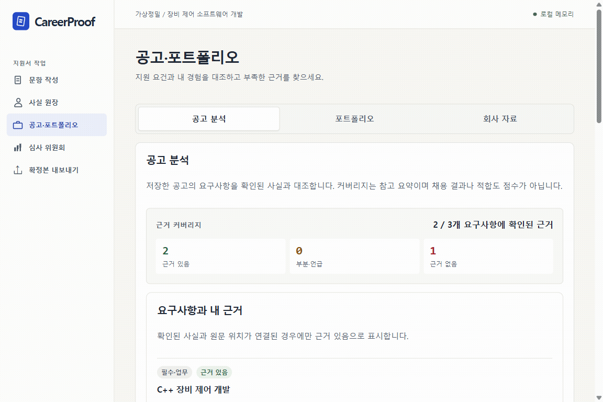
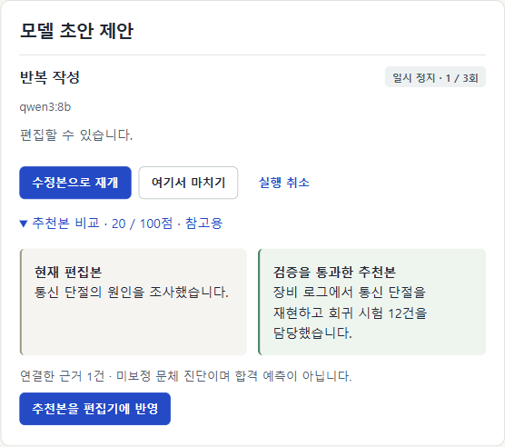

# CareerProof

한국어 자기소개서와 경력기술서를 위한 로컬 작성·심사 워크벤치입니다. 공고가 요구하는 기술을 내 경험과 대조하고, 확인한 사실로 답변을 작성한 뒤 다섯 관점에서 감점 근거를 원문과 함께 읽습니다. 제출할 버전은 사용자가 직접 확정합니다.



## 실행

저장소 루트에서 Python 3.12로 실행한 뒤 브라우저에서 [로컬 작업 공간](http://127.0.0.1:8765)을 엽니다.

```sh
python -m backend
```

일반 편집에는 Python 표준 라이브러리와 최신 브라우저를 사용합니다. 서버에서 반복 작성을 이어가려면 Node.js 22.12 이상을 사용하세요. Docker 환경에서는 `docker compose up --build`로 Node와 PDF 추출기를 포함해 실행할 수 있습니다. 기본 바인딩은 `127.0.0.1:8765`입니다.

처음 방문하면 **가상 지원서로 체험**을 누르세요. 시험 기록 3건, 장비 제어 문항과 공고가 준비되어 있습니다. **공고·포트폴리오 → 문항 작성 → 확정 검토**까지 키 없이 둘러볼 수 있습니다. 모델 전송은 작성·심사 화면에서 직접 시작합니다.

## 첫 답변 작성

1. 회사명과 직무를 입력해 프로젝트를 만듭니다.
2. **사실 원장**에서 경험과 출처를 적거나 [가상 JSON Resume 예제](examples/sample-resume.json)를 가져옵니다. 원문과 대조한 항목에서 **사실 확인**을 누릅니다.
3. **문항 작성**에서 문항과 분량 제한을 입력합니다. 사이트의 계산 방식을 모르면 **사이트 표시값으로 글자 수 보정**을 열고 예문을 실제 지원 사이트에 붙여 넣어 표시값을 비교할 수 있습니다.
4. 확인한 사실을 선택하고 답변을 작성한 뒤 **편집본 저장 → 확정 검토 → 이 버전 확정**을 누릅니다. 예제의 반복 시험은 12건입니다. 본문에 13건이라고 쓰면 화면에 해당 수치가 표시되고, 본문이나 근거를 바로잡을 때까지 확정을 보류합니다.
5. **확정본 내보내기**에서 문항별 TXT 또는 **확정본 인쇄 · PDF 저장**을 선택합니다. 작업을 보관하려면 작업 JSON도 내려받으세요. 원장·공고·포트폴리오·저장한 편집본이 포함됩니다. 위원회 보고서는 별도 JSON으로 저장합니다.

## 공고 분석과 심사

| 화면 | 할 수 있는 일 |
|---|---|
| 공고·포트폴리오 | 공고를 붙여 넣어 필수·우대 요건과 문항별 문자·바이트·줄 제한을 가져옵니다. 요건별로 확인된 경험, 단순 언급, 누락을 원문 위치와 대조합니다. |
| 포트폴리오 입력 | PDF·MD·TXT·DOCX·HWPX를 최대 5MiB까지 읽습니다. 추출한 문장을 직접 선택하고 사실 원장에서 확인합니다. PDF는 설치된 `pdftotext`를 사용하며 이미지 공고는 텍스트 붙여넣기로 처리합니다. |
| 회사·저장소 자료 | 직접 확인한 공식 사이트 문구와 출처를 기록합니다. 사용자 요청 시 공개 GitHub의 README·테스트·CI 설정·라이선스 경로를 커밋에 연결합니다. OpenDART 기업개황 조회에는 고유번호와 사용자 키가 필요합니다. |
| 심사 위원회 | 확정본 또는 명시적으로 선택한 저장 초안을 평가합니다. Fast는 한 번에 5개 역할, Deep은 역할별로 최대 3회 독립 호출합니다. 15개 앵커 기준의 환산, 분모, 인용 위치를 코드로 검증합니다. 자료 부족·잘못된 인용·예산 소진은 결과에 표시됩니다. |
| 외부 점검 | 저장한 리비전에 외부 도구의 전체·문단 점수를 직접 기록할 수 있습니다. 참고 문서와 연속 네 단어가 겹치는 구간을 브라우저에서 확인합니다. 비교 범위는 입력한 두 문서입니다. |

같은 PDF를 OpenResume와 CareerProof에서 읽고, 같은 기술어와 문장을 Resume Matcher와 CareerProof에서 비교했습니다. 독립 작성 한국어 요건 24건에서는 근거가 충분한 8건 중 1건만 자동 인식했습니다. 도구별 개선 목표, 오탐·누락과 재현 명령을 공개합니다. [성능 목표와 실측 결과](docs/performance-goals.md) · [UI와 제품 설계 비교](docs/release-comparison.md)

## 편집과 검증 범위

| 기능 | 현재 동작 |
|---|---|
| 사실과 버전 | JSON Resume의 경력·프로젝트·기술·학력·자격을 출처 경로와 함께 가져옵니다. 확정에는 확인된 근거가 필요합니다. 수치와 단위는 연결한 사실과 대조하고, 역할·인과관계·문장 전체의 의미는 사용자가 검토합니다. 파생 비율은 측정 근거가 있는 사실로 추가한 뒤 연결합니다. |
| 분량 | 표시 문자 또는 UTF-16, 줄바꿈, 이모지, 공백 규칙을 선택할 수 있습니다. UTF-8·CP949 바이트와 줄 제한도 동시에 검사합니다. 보정 예문으로 문자 규칙의 후보를 좁히고 바이트 제한과 인코딩은 별도로 지정합니다. |
| 문체 | 형식 반복·상투 표현·구체성 결핍을 문장과 연결합니다. 300자 미만은 판정을 보류합니다. 점수는 미보정 규칙의 진단값이며 합격 예측이나 작성자 판별의 정확도를 나타내지 않습니다. |
| 모델 초안 | 문항과 선택한 사실을 확인하고 단일 제안 또는 1~10회 반복 작성을 실행합니다. 추천본을 편집기에 반영하는 동작과 제출할 버전을 확정하는 동작은 독립적입니다. |

### 일시 정지하고 수정한 뒤 이어 쓰기

1. 작성할 문항에서 근거를 선택하고 **반복 작성 설정**을 엽니다. 최대 횟수와 선택 사항인 목표 문체 지수를 입력합니다. Anthropic을 선택하면 전체 실행의 USD 예산과 전송할 자료를 확인합니다.
2. 실행 중 **일시 정지**를 누르면 현재 회차의 응답을 검사한 뒤 편집기가 열립니다. 본문을 수정하거나 사실 원장에서 새 경험을 확인하고 문항에 연결하세요.
3. **수정본으로 재개**하면 편집 내용을 저장하고 남은 회차로 이어갑니다. Anthropic을 사용하면 키를 다시 입력합니다. 거절된 제안은 다음 회차의 기준본을 덮어쓰지 않습니다. 근거 보강이 필요하면 화면에 질문을 표시합니다.
4. **여기서 마치기**를 누르거나 종료 조건에 도달하면 **추천본 비교**를 열어 추천본을 확인합니다. 원하는 본문을 편집기에 반영하고 직접 확정합니다. 300자 미만 답변은 목표 지수에 의한 종료를 보류합니다.

자동 후보는 분량과 수치·단위, 선택한 모든 사실 ID, 사실과 본문에서 함께 확인할 수 있는 표현을 검사합니다. 원장에 없는 영문 도구명·식별자도 보류할 수 있습니다. 같은 단어가 문장에 있어도 주체나 인과관계는 달라질 수 있으므로 추천본을 반영하기 전에 내용을 확인하세요.



**로컬 서버**에서 실행하면 작업 사본과 추천본이 프로세스 메모리에 남아 탭을 닫아도 작성이 계속됩니다. 같은 브라우저와 포트에서 **서버 작성 목록 → 서버 버전 열기**로 돌아올 수 있습니다. 두 탭에서 같은 버전을 편집하면 오래된 변경은 409로 보류하며, 해당 탭의 편집 내용을 비교하고 보관할 수 있습니다. 서버를 재시작하면 영속 이벤트에 중단 사유가 남습니다. 이때는 작업 JSON을 복원하고 키를 다시 입력해 새 실행을 시작하세요. **이 탭에서 실행**을 선택한 경우 탭이 닫히면 후속 회차도 중단됩니다.

### 선택한 모델로 초안 받기

- **Ollama**를 사용할 때는 로컬 Ollama를 실행하고 **작성 설정**에 이미 내려받은 모델 이름을 입력합니다. 서버는 로컬 Ollama의 11434번 포트로 구조화된 초안을 요청합니다. [Ollama 구조화 출력](https://docs.ollama.com/capabilities/structured-outputs)
- **Anthropic BYOK**는 `claude-haiku-4-5-20251001`을 지원합니다. 사용자가 보낼 문항·사실·추가 마스킹 항목·요청당 예산을 확인한 뒤 키를 입력합니다. 서버가 이메일·전화번호·주민번호 패턴과 지정한 이름·주소를 가리고, 토큰 사전 계산 결과와 최대 출력 1,200토큰으로 예상 비용을 검사합니다. 응답에 표시하는 사용액은 제공자의 토큰 사용량과 저장소 가격표로 계산합니다. [가격표와 기준일](backend/pricing.json) · [모델 및 공식 요금](https://platform.claude.com/docs/en/models/haiku-4-5/overview)
- **OpenAI·Gemini BYOK**는 가격표에 지정한 모델로 요청합니다. 텍스트 요청 크기와 최대 출력으로 보수적으로 사전 검사하고 제공자가 반환한 사용량을 합산합니다. 계정별 모델 제공 여부, 실제 청구액 및 무료 등급의 데이터 정책은 제공자에서 확인하세요. [지원 모델·공식 가격 출처](backend/pricing.json)
- 반복 요청에는 기준 본문과 직전 점검 의견도 포함됩니다. 서버는 클라우드에 보내는 이 필드에도 같은 마스킹을 적용합니다. 브라우저는 실행에 필요한 동안 키를 메모리에 보관하고 일시 정지·종료 때 지웁니다. 서버의 마스킹 표는 호출 단위입니다. 개인 이름·주소와 자유 서술을 확인한 뒤 전송하세요.
- 비용은 최대 출력까지 사전 검사하고 확인한 실사용량을 회차마다 차감합니다. 응답 형식이 잘못돼도 확인된 과금은 반영합니다. 유료 호출이 발송된 후 사용량을 확인할 수 없으면 같은 실행의 재개를 차단합니다. 브라우저에서 수신을 중단해도 이미 전송한 호출에는 비용이 발생할 수 있습니다.

### 실행 기록의 저장 위치

본문·사실·API 키는 이벤트 기록에서 제외합니다. 로컬 서버는 기본적으로 `~/.careerproof/history.sqlite3`에 회차 메타데이터를 기록합니다. `CAREERPROOF_DATA_DIR`로 저장 폴더를 바꿀 수 있고 Compose는 `careerproof-history` 볼륨을 사용합니다. 실행 선택 목록에서 개별 기록을 삭제할 수 있습니다. 작업 JSON에는 사용자가 작성한 원문이 포함됩니다.

기록은 순번대로만 추가합니다. 같은 순번과 내용의 재전송은 한 번만 반영하고, 내용이 다르거나 순번이 비면 거절합니다. 열람할 때는 브라우저의 HttpOnly 쿠키와 실행별 단기 토큰을 사용합니다. 화면은 fetch로 SSE를 읽고 연결이 끊어지면 마지막으로 읽은 순번부터 다시 요청합니다. 같은 모델 요청 ID의 단기 영수증은 서버 메모리에 두어 응답 재전송이 중복 생성으로 이어지는 것을 막습니다.

**개인정보와 작업 삭제**에서 확인을 거치면 현재 탭의 작업과 이 브라우저 소유자의 서버 작업·전체 실행 기록을 지웁니다. 이미 내려받은 파일과 다른 탭은 직접 정리하세요. 처리 중인 모델 호출과 사용량 정산은 완료를 기다리며, 완료된 요청의 중복 방지용 응답 사본은 서버 메모리에서 최대 10분 후 만료됩니다.

## 검증

저장소 루트에서 실행합니다. Python 테스트는 임시 로컬 HTTP 서버와 모의 공급자 응답을 사용합니다. JavaScript 테스트는 Node.js 내장 테스트 러너로 실행합니다.

```sh
python -m unittest discover -s tests -p "test_*.py"
npm test
node scripts/evaluate.mjs
```

가상 경계 사례 24개를 모두 재현했습니다. 이 자료에는 저자 분류용 정답 레이블이 없습니다. 별도로 동의받은 평가셋으로 길이 구간별 보류 수와 AUROC·저오탐 기준 결과를 측정하는 방법을 제공합니다. [스모크 사례](tests/fixtures/style-smoke.json) · [평가 방법](docs/release-comparison.md)

## 설계와 개발 단계

현재 제공 범위는 로컬 BYOK 웹앱입니다. Chrome 확장, 실사이트 자동 입력, 계정·결제·크레딧 운영은 후속 제품 단계입니다. 설계 문서의 단계 표기는 작성 시점의 계획이며 현재 동작과 시험 범위는 위 실행 안내와 검증 자료를 기준으로 확인하세요. [v0.3 구현 계약](docs/engineering-contracts-v0.3.md)

- [제품 설계와 단계별 기준](docs/careerproof-design-v0.3.md)
- [화면 명세와 오픈소스·상용 UI 비교](docs/ui-spec-v0.3.md)
- [한국어 AI 문체·이력서 오픈소스 조사](docs/careerproof-design-v0.2.2.md)
- [실행·저장·API 설계 계약](docs/engineering-contracts-v0.3.md)
