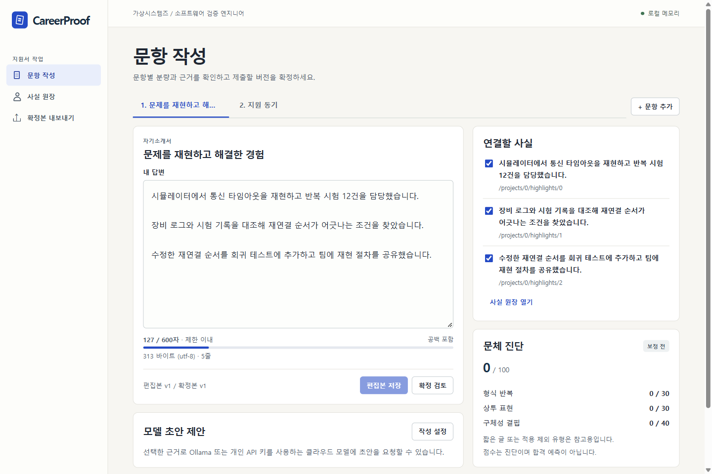

# CareerProof

한국어 자기소개서와 경력기술서를 작성하는 로컬 웹앱입니다. 문항별로 경험의 출처와 분량을 확인하고, 제출할 버전을 직접 확정합니다. 확정 이후에 표현을 다시 고쳐도 제출용 TXT에는 선택한 버전이 담깁니다.



## 실행

저장소 루트에서 Python 3.12로 실행한 뒤 브라우저에서 [로컬 작업 공간](http://127.0.0.1:8765)을 엽니다.

```sh
python -m backend
```

일반 편집에는 Python 표준 라이브러리와 최신 브라우저만 사용합니다. 프런트엔드는 브라우저가 직접 읽는 ES 모듈입니다. 포트를 바꾸려면 `python -m backend --port 8766`을 실행하세요. Docker 환경을 위한 `docker compose up --build` 구성도 있습니다.

## 첫 답변 작성

1. 회사명과 직무를 입력해 프로젝트를 만듭니다.
2. **사실 원장**에서 경험과 출처를 적거나 [가상 JSON Resume 예제](examples/sample-resume.json)를 가져옵니다. 원문과 대조한 항목에서 **사실 확인**을 누릅니다.
3. **문항 작성**에서 문항과 분량 제한을 입력합니다. 사이트의 계산 방식을 모르면 **사이트 표시값으로 글자 수 보정**을 열고 예문을 실제 지원 사이트에 붙여 넣어 표시값을 비교할 수 있습니다.
4. 확인한 사실을 선택하고 답변을 작성한 뒤 **편집본 저장 → 확정 검토 → 이 버전 확정**을 누릅니다. 예제의 반복 시험은 12건입니다. 본문에 13건이라고 쓰면 화면에 해당 수치가 표시되고, 본문이나 근거를 바로잡을 때까지 확정을 보류합니다.
5. **확정본 내보내기**에서 제출용 TXT를 받습니다. 이어서 편집하려면 **작업 JSON 다운로드**도 선택하세요. 원장·문항·저장된 리비전·확정 버전은 이 파일에 들어갑니다. 작업 중인 탭을 닫으면 메모리의 작업은 사라집니다.

## 편집과 검증 범위

| 기능 | 현재 동작 |
|---|---|
| 사실과 버전 | JSON Resume의 경력·프로젝트·기술·학력·자격을 출처 경로와 함께 가져옵니다. 확정에는 확인된 근거가 필요합니다. 수치와 단위는 연결한 사실과 대조하고, 역할·인과관계·문장 전체의 의미는 사용자가 검토합니다. 파생 비율은 측정 근거가 있는 사실로 추가한 뒤 연결합니다. |
| 분량 | 표시 문자 또는 UTF-16, 줄바꿈, 이모지, 공백 규칙을 선택할 수 있습니다. UTF-8·CP949 바이트와 줄 제한도 동시에 검사합니다. 보정 예문으로 문자 규칙의 후보를 좁히고 바이트 제한과 인코딩은 별도로 지정합니다. |
| 문체 | 형식 반복·상투 표현·구체성 결핍을 문장과 연결합니다. 300자 미만은 판정을 보류합니다. 점수는 미보정 규칙의 진단값이며 합격 예측이나 작성자 판별의 정확도를 나타내지 않습니다. |
| 모델 초안 | 문항과 선택한 사실을 확인하고 단일 제안 또는 1~10회 반복 작성을 실행합니다. 추천본을 편집기에 반영하는 동작과 제출할 버전을 확정하는 동작은 독립적입니다. |

### 일시 정지하고 수정한 뒤 이어 쓰기

1. 작성할 문항에서 근거를 선택하고 **반복 작성 설정**을 엽니다. 최대 횟수와 선택 사항인 목표 문체 지수를 입력합니다. Anthropic을 선택하면 전체 실행의 USD 예산과 전송할 자료를 확인합니다.
2. 실행 중 **일시 정지**를 누르면 현재 회차의 응답을 검사한 뒤 편집기가 열립니다. 본문을 수정하거나 사실 원장에서 새 경험을 확인하고 문항에 연결하세요.
3. **수정본으로 재개**하면 편집 내용을 저장하고 남은 회차로 이어갑니다. Anthropic을 사용하면 키를 다시 입력합니다. 거절된 제안은 다음 회차의 기준본을 덮어쓰지 않습니다. 근거 보강이 필요하면 화면에 질문을 표시합니다.
4. **여기서 마치기**를 누르거나 종료 조건에 도달하면 **추천본 비교**를 열어 추천본을 확인합니다. 원하는 본문을 편집기에 반영하고 직접 확정합니다. 300자 미만 답변은 목표 지수에 의한 종료를 보류합니다.

자동 후보는 분량과 수치·단위, 선택한 모든 사실 ID, 사실과 본문에서 함께 확인할 수 있는 표현을 검사합니다. 원장에 없는 영문 도구명·식별자도 보류할 수 있습니다. 같은 단어가 문장에 있어도 주체나 인과관계는 달라질 수 있으므로 추천본을 반영하기 전에 내용을 확인하세요.


**최근 반복 작성 기록**에는 회차, 상태 전환, 보류 사유와 확인된 비용이 남습니다. 새로고침 후 같은 브라우저와 같은 주소·포트에서 열면 마지막으로 저장된 상태를 확인할 수 있습니다. 작성은 열린 탭이 조율하므로 탭을 닫으면 후속 회차가 시작되지 않습니다. 저장한 작업 JSON을 가져오면 본문 작업을 이어갈 수 있습니다. 미반영 추천본과 실행 중인 루프의 복구는 후속 범위입니다.

### 선택한 모델로 초안 받기

- **Ollama**를 사용할 때는 로컬 Ollama를 실행하고 **작성 설정**에 이미 내려받은 모델 이름을 입력합니다. 서버는 로컬 Ollama의 11434번 포트로 구조화된 초안을 요청합니다. [Ollama 구조화 출력](https://docs.ollama.com/capabilities/structured-outputs)
- **Anthropic BYOK**는 `claude-haiku-4-5-20251001`을 지원합니다. 사용자가 보낼 문항·사실·추가 마스킹 항목·요청당 예산을 확인한 뒤 키를 입력합니다. 서버가 이메일·전화번호·주민번호 패턴과 지정한 이름·주소를 가리고, 토큰 사전 계산 결과와 최대 출력 1,200토큰으로 예상 비용을 검사합니다. 응답에 표시하는 사용액은 제공자의 토큰 사용량과 저장소 가격표로 계산합니다. [가격표와 기준일](backend/pricing.json) · [모델 및 공식 요금](https://platform.claude.com/docs/en/models/haiku-4-5/overview)
- 반복 요청에는 기준 본문과 직전 점검 의견도 포함됩니다. 서버는 클라우드에 보내는 이 필드에도 같은 마스킹을 적용합니다. 브라우저는 실행에 필요한 동안 키를 메모리에 보관하고 일시 정지·종료 때 지웁니다. 서버의 마스킹 표는 호출 단위입니다. 개인 이름·주소와 자유 서술을 확인한 뒤 전송하세요.
- 비용은 최대 출력까지 사전 검사하고 확인한 실사용량을 회차마다 차감합니다. 응답 형식이 잘못돼도 확인된 과금은 반영합니다. 유료 호출이 발송된 후 사용량을 확인할 수 없으면 같은 실행의 재개를 차단합니다. 브라우저에서 수신을 중단해도 이미 전송한 호출에는 비용이 발생할 수 있습니다.

### 실행 기록의 저장 위치

본문·사실·API 키는 이벤트 기록에서 제외합니다. 로컬 서버는 기본적으로 `~/.careerproof/history.sqlite3`에 회차 메타데이터를 기록합니다. `CAREERPROOF_DATA_DIR`로 저장 폴더를 바꿀 수 있고 Compose는 `careerproof-history` 볼륨을 사용합니다. 실행 선택 목록에서 개별 기록을 삭제할 수 있습니다. 작업 JSON에는 사용자가 작성한 원문이 포함됩니다.

기록은 순번대로만 추가합니다. 같은 순번과 내용의 재전송은 한 번만 반영하고, 내용이 다르거나 순번이 비면 거절합니다. 열람할 때는 브라우저의 HttpOnly 쿠키와 실행별 단기 토큰을 사용합니다. 화면은 fetch로 SSE를 읽고 연결이 끊어지면 마지막으로 읽은 순번부터 다시 요청합니다. 같은 모델 요청 ID의 단기 영수증은 서버 메모리에 두어 응답 재전송이 중복 생성으로 이어지는 것을 막습니다.

## 검증

저장소 루트에서 실행합니다. Python 테스트는 임시 로컬 HTTP 서버와 모의 공급자 응답을 사용합니다. JavaScript 테스트는 Node.js 내장 테스트 러너로 실행합니다.

```sh
python -m unittest discover -s tests -p "test_*.py"
npm test
```

가상 문항·경계 사례 24개는 한국어 규칙의 동작을 재현하기 위한 자료입니다. 사람 작성 자소서에 대한 오탐률과 탐지 정확도는 아직 측정하지 않았습니다. [스모크 사례](tests/fixtures/style-smoke.json)

## 설계와 개발 단계

Phase 1의 수동 작성, 단일 초안과 탭 기반 다회차 실행을 사용할 수 있습니다. 서버 워커를 통한 실행 소유권·탭 간 편집 충돌 제어와 작업 복구는 남은 Phase 1 설계 항목입니다. 5인 심사위원회와 회사·포트폴리오 분석은 Phase 2입니다. [v0.3 구현 계약](docs/engineering-contracts-v0.3.md)

- [제품 설계와 단계별 기준](docs/careerproof-design-v0.3.md)
- [화면 명세와 오픈소스·상용 UI 비교](docs/ui-spec-v0.3.md)
- [한국어 AI 문체·이력서 오픈소스 조사](docs/careerproof-design-v0.2.2.md)
- [실행·저장·API 설계 계약](docs/engineering-contracts-v0.3.md)
