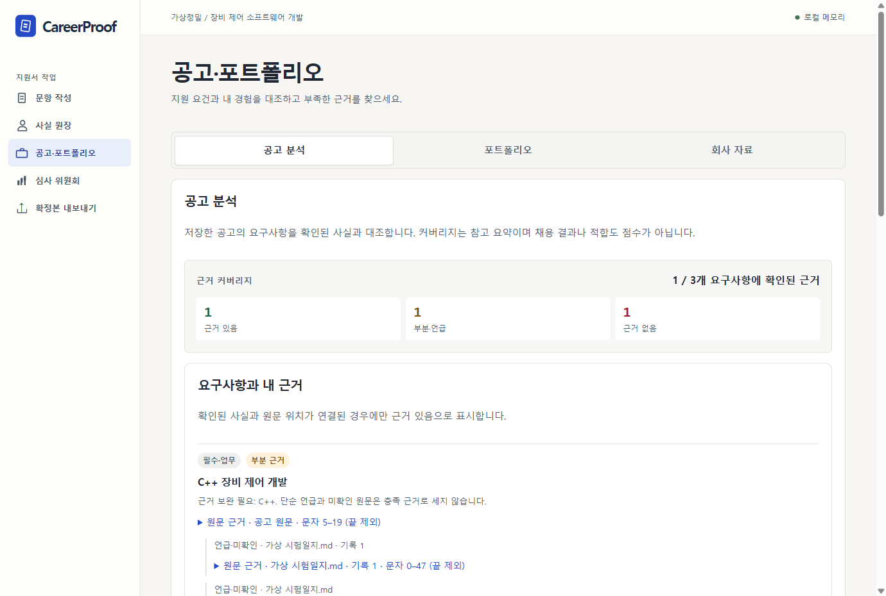

# 공개 프로젝트 비교와 검증 기록

2026년 11월 28일, 한국어 채용 공고를 읽는 지원자가 자신의 경험을 근거로 답변을 작성하고 제출할 버전을 확정하는 과제를 기준으로 비교했다. 비교 대상마다 해결하는 문제가 달라 기능별로 관측 대상을 기록했다.

## 같은 PDF를 읽은 결과

개인정보가 없는 한 페이지짜리 문서에 `Evidence: 12 test cases.` 한 문장을 넣었다. Windows Chromium에서 OpenResume 공개 파서를 먼저 연 뒤 외부 HTTP 요청을 차단하고 이 파일을 선택했다. CareerProof에서는 같은 파일을 로컬 추출기에 입력했다.

| 관측 | OpenResume | CareerProof |
|---|---|---|
| 실제 출력 | Profile의 Summary에 원문 한 문장이 들어갔다. 이름과 이메일 칸은 비어 있었다. | 첫 페이지 미리보기에 같은 문장이 들어갔다. 사용자가 선택한 문장은 페이지와 출처가 붙은 미확인 사실로 가져올 수 있다. |
| 이 결과로 비교한 범위 | 영문 단일 열 파일 1건의 텍스트 추출과 필드 분류 | 같은 파일의 텍스트 추출과 사실 후보 선택 흐름 |

샘플은 아래 명령으로 재현할 수 있다. [OpenResume 공개 파서](https://www.open-resume.com/resume-parser) · [가상 PDF 생성 코드와 추출 테스트](../tests/test_evidence.py)

```sh
python -c "import sys,pathlib; sys.path.insert(0,'tests'); from test_evidence import one_page_pdf; pathlib.Path('comparison.pdf').write_bytes(one_page_pdf())"
```

## 프로젝트별 설계 반영

| 비교 대상 · 확인한 라이선스 | 확인한 자료 | CareerProof에 반영한 결정 |
|---|---|---|
| OpenResume · AGPL-3.0 | 공개 파서 실제 동작, 영문 프로필 필드와 파싱 단계. [비교 시점 소스](https://github.com/xitanggg/open-resume/tree/4f8255a2c763479837f69f1dccf2a3338730cd79) | 지원자가 추출 문장을 원문과 대조하고 사용 여부를 결정한다. 표·이미지·스캔 문서는 직접 확인하도록 추출 경계를 표시한다. |
| Reactive Resume · MIT | 편집·인쇄·데이터 이동, 수정 제안에서 전후 내용을 보는 흐름. [비교 시점 소스](https://github.com/reactive-resume/reactive-resume/tree/907ffd8b057bcd340983920c8cbc8ffd5fdcc585) · [공식 편집기 가이드](https://docs.rxresu.me/guides/using-the-assistant) | 작업 JSON과 제출 버전을 구분했다. 인쇄·TXT는 확정한 버전을 사용하고 모델 제안은 편집기에서 검토한다. |
| Resume Matcher · Apache-2.0 | 공고에 맞춰 이력서를 작성하는 로컬 도구와 모델 선택. [비교 시점 소스](https://github.com/srbhr/Resume-Matcher/tree/959e4587dab33d7ff849d822b8182e11e7669dfc) | 공고 문구에 대한 기술 언급과 확인된 수행 근거를 구분했다. 사용자가 근거가 부족한 요건과 원문을 직접 확인할 수 있다. |
| Fast-DetectGPT · MIT | 생성 확률을 이용하는 탐지 실험과 실행 환경. [저자 저장소](https://github.com/baoguangsheng/fast-detect-gpt/tree/971b05202bac2bb504d60c0ac0812fea7a8f7c82) | 기본 편집에서는 외부 모델 없이 문장별 규칙을 보여 준다. 사람·AI 레이블이 있는 평가셋은 별도 하네스에서 측정한다. |
| Binoculars · BSD-3-Clause | 모델 쌍의 점수를 사용하는 연구 구현. [저자 저장소](https://github.com/ahans30/Binoculars/tree/c8ae2f90d50ee696418bc71d8d9e5020e5f9d7b8) | 한국어 자소서 표본과 검증된 임계값이 확보될 때까지 연구용 모델 점수의 도입을 보류했다. |

상용 UI는 자소설닷컴 공식 도움말의 편집·저장 표시와 Teal 공식 자료의 요건별 점검 방식을 참고했다. 각 화면에서 확인한 동작과 참고 범위는 화면 명세에 기록했다. [상용·공개 UI 관찰 기록](ui-spec-v0.3.md)



가상 자료를 모의 공급자에게 보낸 Fast 심사에서는 감점 문장을 눌러 실제 답변의 같은 구간을 강조하고, 내려받은 JSON을 다시 가져와 인용과 소계를 검증했다. 캡처의 점수는 이 시험 응답에서 계산한 값이다. [심사 결과 화면](ui/committee-report.png)

## 사용자가 재현할 수 있는 품질 기준

| 시나리오 | 성공 기준 | 검증 방법 |
|---|---|---|
| 근거 있는 제출본 | 원장에 없는 수치가 확정 단계에서 차단되고, 후속 편집 후에도 확정본을 출력한다. | `tests/workspace.test.mjs`, 앱에서 **가상 지원서로 체험** |
| 반복 작성 | 같은 명령의 재전송으로 추가 호출이 발생하지 않고, 다른 탭이 먼저 저장한 뒤 오래된 편집을 보내면 충돌을 알린다. | `tests/test_workers.py`, `tests/remote-runs.test.mjs`, 실제 브라우저 두 탭에서 저장·다시 열기 |
| 비용과 복구 | 예산 초과 사전 차단, 응답 처리 실패 후에도 확인된 비용 유지, 사용량 불명 시 자동 재호출 중단 | `tests/test_extra_providers.py`, `tests/test_committee.py`, `tests/test_evidence.py` |
| 인용과 점수 | 선택한 문장의 위치가 원문과 일치하며, 평가할 자료가 빠지면 분모가 줄어든다. Deep의 범위는 같은 기준으로 관측한 회차에서 계산한다. | `tests/test_committee.py`, `tests/review-ui.test.mjs` |
| 한글 편집과 보존 | CP949에서 표현할 수 없는 문자, 줄바꿈·이모지·분량 상한을 검사하고 이전 버전의 백업을 읽는다. | `tests/analysis.test.mjs`, `tests/calibration.test.mjs`, `tests/workspace.test.mjs` |

모델 연동은 가상 응답을 반환하는 전송 계층으로 검증했다. OpenResume 공개 저장소 조회에서는 README·테스트·라이선스 경로가 확인되고 해당 커밋에서 GitHub Actions 워크플로 파일은 발견되지 않았다. 모델이 작성한 한국어의 품질, 실사용 비용, 각 공급자 계정의 모델 접근 권한은 별도의 관측 항목이다. OpenResume 외 비교 제품은 공식 소스·문서·화면 관찰 범위다. 경쟁 제품 전체의 실사용 속도나 품질 순위는 측정하지 않았다.

## 문체 평가

`node scripts/evaluate.mjs`를 실행하면 모델 호출 없이 가상 스모크 사례 **24건 중 24건 통과**를 재현한다. 문구·임계값 회귀를 확인하는 자료다. 사람 작성 자소서의 오탐률과 보정은 별도 평가가 필요하다.

동의를 받은 사용자 자료는 공개 저장소 밖에서 관리한다. 이름·연락처·소속을 익명화하고 자료별 수집 경로, 사용 허가, 생성 모델과 편집 여부를 보관한다. 동일 작성자·원본에서 파생된 문서는 같은 분할에 두고 개발에 사용하지 않은 평가 자료로 측정한다.

`node scripts/evaluate.mjs /path/to/holdout.jsonl`에 한 줄 한 객체로 `text`, `label` (`human` 또는 `ai`), `source`, `permission`을 전달한다. 출력에는 원문을 포함하지 않는다. 길이별 보류 수, 평가 가능한 두 집단 크기, AUROC와 관측 FPR 5% 이하에서의 최대 TPR을 보고한다. 집단이 한쪽뿐이면 성능 지표는 `null`이다. 짧은 글을 보류한 비율과 사용 모델 목록도 성능 수치 옆에 함께 기록한다.
